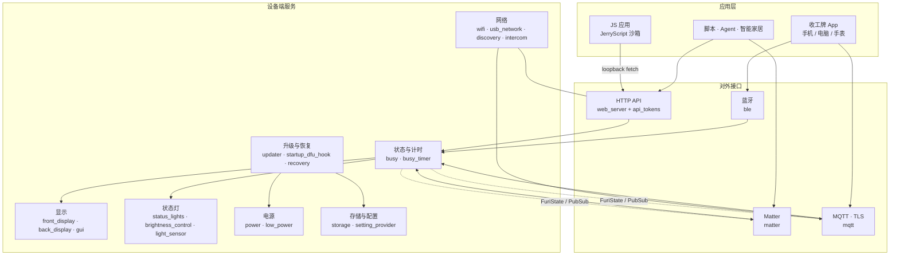
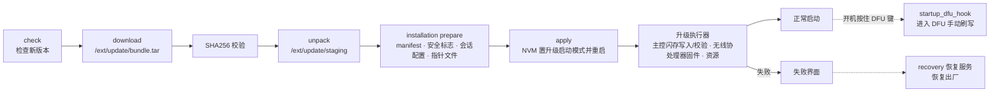

# 收工牌 · 设备固件

面向共享办公、固定工位与居家办公工作者的桌面状态设备，由用户本人掌控。围绕 **表达状态 → 减少打扰 → 结束工作 → 回顾状态** 这条用户闭环，规划"桌面状态牌 + App"的软硬件一体产品；本仓库是设备端固件（双 MCU）与默认 JavaScript 应用。

- 正面 72×16 全彩 RGB LED 点阵屏 + 背面 160×80 灰阶副屏，RGB 状态灯，环境光自动调光
- 4 枚实体按键 + 旋钮，内置电池，USB-C
- 主控 MCU + 无线协处理器（Wi-Fi 6 / BLE），二者经 `intercom` 服务通信

产品介绍页见配套网站仓库（`shangxiabanbaijian/code/website`，路由 `/sgp/product`）。

## 仓库结构

| 目录 | 内容 |
|---|---|
| [`applications/`](applications/) | 固件内应用与服务：`main`（主界面）、`services`（后台服务）、`settings`（设置）、`system`（升级等系统应用）、`debug`（调试，不进发布版）；每个应用由 `application.fam` 声明 |
| [`applications_js/`](applications_js/) | 默认 JavaScript 应用（时钟、天气、示例），开发说明见 [applications_js/AGENTS.md](applications_js/AGENTS.md) |
| [`lib/`](lib/) | 自研与第三方库：显示 / 网络（lwIP、mongoose）/ JerryScript / Matter / mbedTLS / TinyUSB 等 |
| [`targets/`](targets/) | HAL 与各硬件目标配置（`f2x` = 主控，`f6x` = 无线协处理器） |
| [`fbt_layers/`](fbt_layers/) | 构建系统层（fbtng、core_libs / Furi、FreeRTOS），均为子模块 |
| [`assets/`](assets/) | 图片、动画、声音、前端资源、OpenAPI（swagger） |
| [`documentation/`](documentation/) | Doxygen 文档源：[快速上手](documentation/Quick%20Start.dox.md)、[构建系统](documentation/Build%20System.dox.md)、[JS 应用](documentation/JavaScript%20Applications.dox.md)、[代码规范](documentation/Code%20Style.dox.md) |
| [`tests/`](tests/) | Python 集成测试 |

## 核心场景与功能模块

从五个核心用户场景出发，映射到固件模块：

| 场景 | 触发条件 | 优先级 | 用户价值 | 主要模块 |
|---|---|---|---|---|
| 专注状态同步 | 按键 / 旋钮切换、App 或 HTTP API 下发、计划表到点 | P0 | 同事一眼看懂你方不方便，不必当面确认 | `main/busy`、`front_display`、`back_display`、`status_lights`、`state_publisher` |
| 番茄钟计时 | 旋钮调时长后按下；智能家居开关打开 | P0 | 专注 / 休息自动循环（单段 5 分钟–8 小时，2–35 轮；单次最长 24 小时） | `busy_timer`、`input`、`audio` |
| 通知免打扰 | 进入工作 / 勿扰状态 | P1 | 手机、电脑、手表同步静音，离开后恢复 | `ble`、`mqtt`、`matter`（专注开关） |
| 远程状态更新 | 远程改留言、通话时自动切"通话中" | P1 | 不在工位也能更新屏幕 | `wifi`、`mqtt`（账号绑定）、`web_server` |
| 便捷扩展接口 | 脚本 / Agent / 智能家居调用；安装 JS 应用 | P2 | 开发者几行代码就能上屏，自建应用沙箱运行 | `web_server`（HTTP API）、`api_tokens`、`js_runner`、`js_app_installer`、`discovery`（mDNS） |

## 架构

三层结构，层间只通过明确的接口交互：



### 服务间通信约定

- 每个服务一个线程，运行自己的 `FuriEventLoop`；**只有服务线程能修改自身状态**，不跨线程共享加锁的状态。
- 服务启动时 `furi_record_create(RECORD_FOO, instance)` 注册，其他模块按名字 `furi_record_open` 获取。
- 公共 API 是薄封装：`furi_check` 参数 → 在栈上组装类型化消息 → 投递到服务的 `FuriMessageQueue` → 阻塞在 `api_lock` 上等待处理结果。
- 消息按 `type` 枚举经 `static const` 处理表分发（`static_assert` 保证表长与枚举一致），不用长 `switch`。
- 状态对外发布用 `FuriState`（可订阅的当前值），事件用 `FuriPubSub`；订阅到的外部事件先转发回本服务线程再处理。

示例：番茄钟进入专注段时，`busy_timer` 发布事件，智能家居桥接把 Matter 开关置为"开"；反过来，在智能家居里打开开关，`busy_timer` 收到 `FuriState` 变化后开始一轮专注。

### 模块清单（节选）

| 模块 | 职责 | 边界 |
|---|---|---|
| `front_display` / `back_display` | 正面 72×16 RGB、背面 160×80 灰阶帧缓冲与亮度、熄屏、低功耗 | 只负责出帧，不关心内容来源 |
| `status_lights` | 灯效预设：常亮 / 渐变 / 彩虹 / 闪烁 / 通知 | 只接收"预设 + 颜色" |
| `light_sensor` / `brightness_control` | 环境光采样（0–15 级）→ 屏幕与灯光自动亮度 | 不直接写屏，经显示服务设置亮度 |
| `busy_timer` | 单次 / 间隔计时、暂停、跳过、延长，状态快照 | 计时结束不推断用户状态 |
| `power` / `low_power` | 电量、充电、重启、软关机；低功耗进入 / 退出加锁 | 其他服务只能 `lock/unlock`，不能强制休眠 |
| `web_server` | HTTP API（附 OpenAPI 文档）、令牌鉴权、Wi-Fi 访问开关 | 业务由各服务 API 完成，自身只做路由与校验 |
| `js_runner` / `js_app_installer` | 安装（stage → install）、启动、退出 JS 应用 | 应用只能访问白名单接口与 `/ext/data` 沙箱目录 |
| `updater` | 检查、下载、校验、解包、安装准备、切换升级启动模式 | 同一时刻只允许一个升级会话 |

## OTA 升级与异常恢复

### 升级链路



- **检查**：开机后约 10 分钟首次检查（可调 1–20 分钟），之后默认每 5 小时一次（1–20 小时）；自动升级默认只在 02:00–05:00 窗口执行。
- **前置条件**：电量 ≥ 40%（调试模式下插 USB 可放行）；升级会话由信号量保证互斥，重复发起返回 `Busy`。
- **安装准备**：校验 manifest 存在且合法，比对升级包与设备的签名 / 加密标志（不一致直接拒绝），写入会话配置与指针文件；指针文件写失败会回滚删除会话配置。
- **启动切换**：`apply` 把 NVM 启动模式置为"升级"后重启；启动代码**先把启动模式清回"正常"再跳转升级**，跳转失败则直接复位，回到原固件。
- **升级执行**：读 manifest → 校验 DFU 镜像 → 写入并校验主控闪存 → 写入并安装无线协处理器固件与应用固件 → 清理并解包资源，每阶段独立上报进度与错误。

### 失败判定与降级路径

| 阶段 | 失败判定（状态码） | 影响 | 降级路径 |
|---|---|---|---|
| 检查 | 网络不可用 / 服务端无响应 | 无 | 保持当前版本，下个检查周期重试 |
| 前置条件 | `BatteryLow`、`Busy` | 不开始升级 | 提示充电；等待当前会话结束 |
| 下载 | `DownloadFailure`、`DownloadAbort`（断网、用户取消） | 仅残留临时文件，运行中的固件不受影响 | 丢弃 `bundle.tar`，下次重新下载 |
| 校验 | `ShaMismatch` | 同上 | 丢弃升级包重新下载；连续失败时暂停自动升级（建议） |
| 解包 | 建目录 / 打开 / 解包失败 | 同上 | 清空 `staging` 后重试；存储异常时提示用户 |
| 安装准备 | manifest 缺失或非法、`SecurityMismatch`、会话配置 / 指针文件写失败 | 不切换启动模式 | 回滚已写入的会话配置；安全标志不匹配的包永久拒绝 |
| 启动切换 | 跳转升级失败 | 启动模式已清回正常 | 自动复位进入原固件，不会循环卡在升级模式 |
| 升级执行中断电 / 出错 | 执行器进入 `Error` 阶段 | 可能处于部分写入状态 | 显示失败界面；保留 staging 中的升级包以便重新进入升级（建议）；仍失败则进入 recovery |
| 无法正常启动 | — | 设备不可用 | **recovery**：显示"Recovering…"，经 updater 执行恢复出厂；**DFU**：开机按住 DFU 键，状态灯橙色闪烁 3 秒警告（期间松开即取消），随后转红进入 DFU，经 USB 刷写 |

> 标"（建议）"的是分析后给出的设计方案，其余为固件现有行为。当前没有 A/B 双分区，"回滚"依赖于：升级前所有失败都不触碰运行中的固件；升级中失败依靠保留的升级包重试、recovery 恢复出厂和 DFU 手动刷写三级兜底。

## 快速开始

构建系统为 `fbt`（封装 SCons），首次运行会自动下载工具链并初始化子模块。Windows 上使用 `fbt.cmd`。

```shell
# 构建两颗 MCU 的固件并打包到 dist/
./fbt

# 只构建某一颗
./fbt TARGET_HW=22     # 主控固件
./fbt TARGET_HW=65     # 无线协处理器固件

# 经 USB 刷写（需设备的 USB 虚拟网卡已就绪，默认包含资源文件）
./fbt flash_usb

# 单独上传资源文件
./fbt resources_upload

# 用 SWD 调试器刷写主固件（需拆机接调试板）
./fbt flash

# 代码格式化 / 检查、单元测试、生成文档
./fbt format
./fbt lint
./fbt FIRMWARE_APP_SET=unit_tests
./fbt doxy

# 生成 VS Code 工作区（.vscode/fbt.code-workspace）
./fbt vscode_dist
```

两颗 MCU 版本不一致时，可用 `INTERCOM_FORCE_VERSION` 跳过 intercom 版本检查，详见[构建系统文档](documentation/Build%20System.dox.md)。

### JS 应用

JS 应用是第三方扩展的推荐方式，**不需要改固件**：脚本在设备内 JerryScript 引擎中运行，通过 loopback `fetch` 调用 HTTP API（仅开放白名单接口），用 `listen("input", …)` 处理按键。USB 连接时设备地址为 `10.0.4.20`：

```sh
curl -X POST 'http://10.0.4.20/api/apps/stage' --data-binary '@com.your.app.tgz'   # 返回 install_key
curl -X POST 'http://10.0.4.20/api/apps/install?install_key=<install_key>'
curl -X POST 'http://10.0.4.20/api/apps/launch?app_id=com.your.app'
```

完整接口见设备内置 OpenAPI 文档（`http://10.0.4.20/docs/`）。

## 开发约定

- 代码风格以 [Code Style](documentation/Code%20Style.dox.md) 为准，提交前运行 `./fbt format`。
- 服务按"`foo.h` 公共 API / `foo_i.h` 私有定义 / `foo_<关注点>.c` 实现 / `settings/` 版本化持久配置"组织；不同 MCU 的代码放在独立源文件，经 `application.fam` 的 `targets` 选择。
- 外部输入（文件、JSON、网络、intercom 帧）一律先校验大小、类型和范围；资源在获取它的函数内按相反顺序释放。
- 修改带非平凡逻辑的库函数时，在 `applications/debug/unit_tests` 补充测试；更多细节见 [AGENTS.md](AGENTS.md)。
