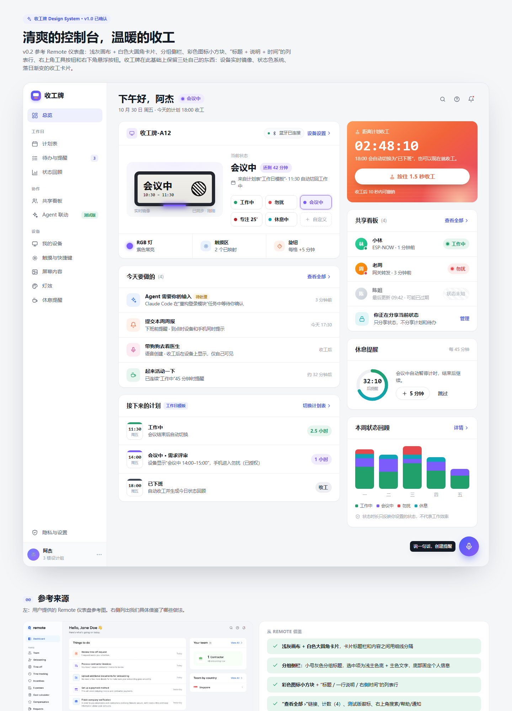
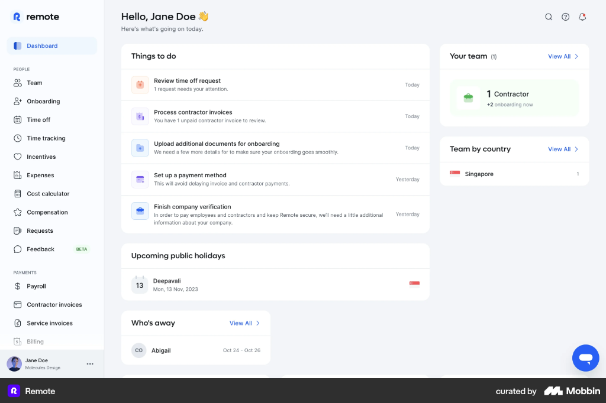
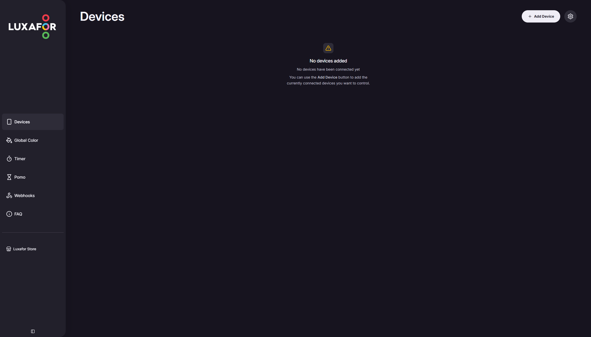
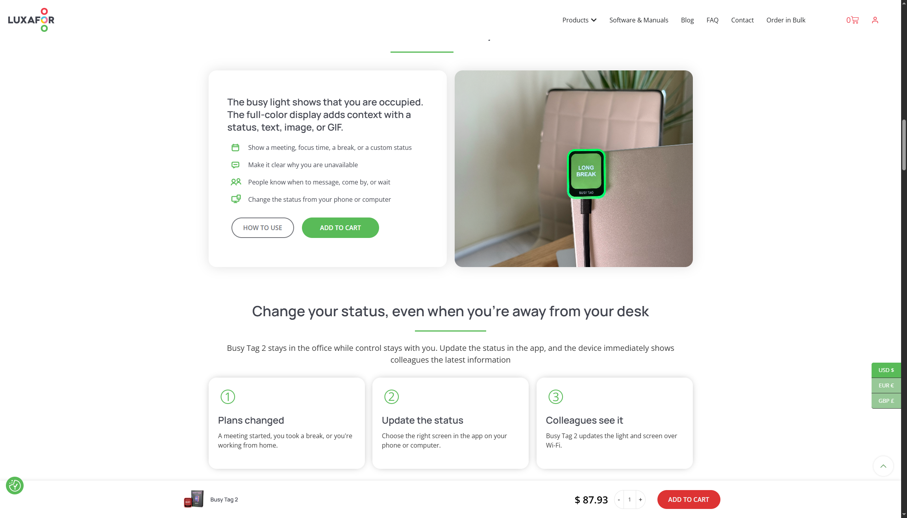
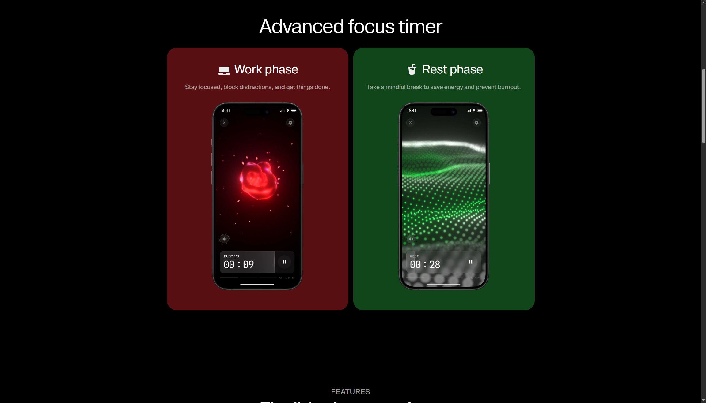
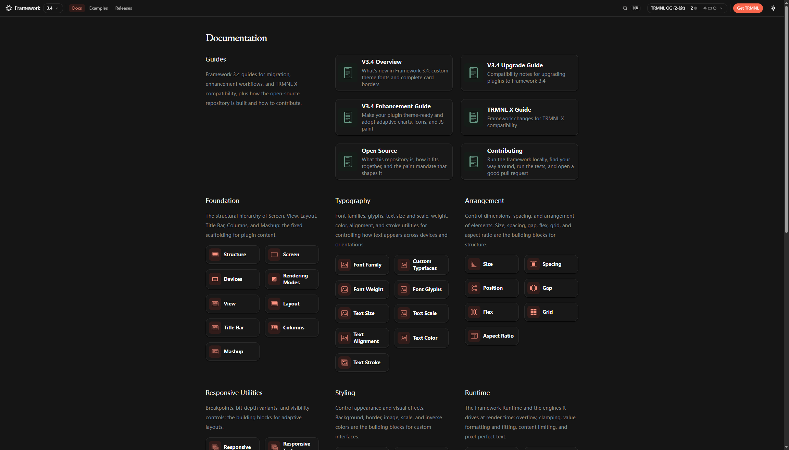
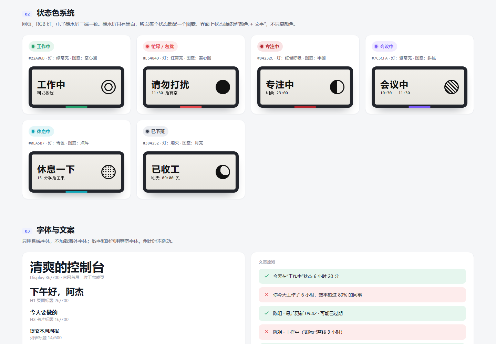
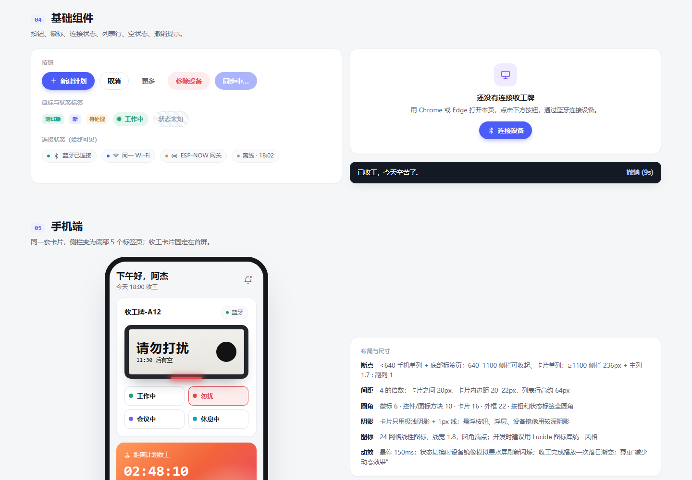
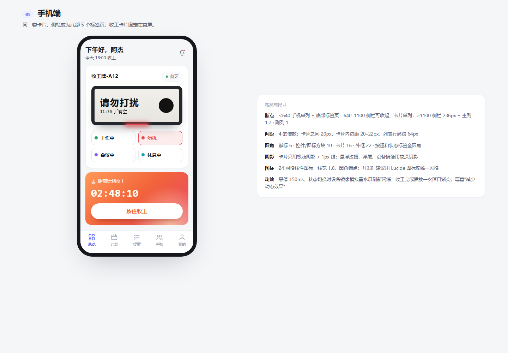

# 收工牌网站 · 前端设计规范 v1.0（已确认）

> 范围：`website/` 网站（功能与后续 App 一致：设备控制、计划表、提醒、回顾、共享看板、设备设置）。
> 可视化示例：浏览器打开 `preview.html`。上一版保留为 `preview-v0.1.html` 便于对比。
> 截图均在 `screenshots/`。竞品数值来自其线上页面的计算样式，只作参考，不照搬品牌元素。

## 版本记录

| 版本 | 日期 | 变化 |
|---|---|---|
| v0.1 | 2026-10-30 | 基于 Luxafor / BusyBox / BUSY / TRMNL 调研，纸感暖灰风格 |
| v0.2 | 2026-10-30 | 按反馈“不够 fancy”，参考 Remote 仪表盘改为现代 SaaS 控制台风格：冷灰画布、白色大圆角卡片、分组侧栏、彩色图标方块、列表行、悬浮按钮；新增靛蓝主色和落日渐变收工卡片 |
| v1.0 | 2026-10-30 | 第 8 节决策全部确认；Token 和基础组件已抽成代码：`website/styles/tokens.css`、`website/styles/components.css`、`website/scripts/hold-button.js` |

---

## 1. 视觉方向

**一句话：清爽的控制台，温暖的收工。**

日常控制界面要像现代 SaaS 仪表盘一样清爽、信息有条理（Remote 方向）。“收工”这一刻用落日渐变卡片，给出明显的情绪变化。



---

## 2. 参考来源

### 2.1 Remote 仪表盘（主要视觉参考，用户提供）



| 借鉴点 | 在收工牌中的用法 |
|---|---|
| 浅灰画布 + 白色大圆角卡片，标题栏与内容之间用细线分隔 | 所有功能模块都用这种卡片 |
| 分组侧栏：小号灰色分组标题，选中项浅主色底 + 主色文字，底部固定个人信息 | 侧栏分为“工作日 / 协作 / 设备”三组 |
| 彩色图标方块 + “标题 / 一行说明 / 右侧时间”的列表行 | “今天要做的”“接下来的计划”“共享看板” |
| “查看全部 ›”、计数（4）、BETA 徽标 | “Agent 联动”标记测试版 |
| 问候语 + 一行今日概况；右上角搜索 / 帮助 / 通知 | “下午好，阿杰” + 当前状态标签 |
| 右下角悬浮按钮 | 用作“语音创建提醒”（PRD 3.14） |

不照搬：它的 HR / 薪资信息结构；不用 emoji 作为界面元素。

### 2.2 同类产品（v0.1 调研，继续沿用的部分）

| 产品 | 截图 | 沿用 |
|---|---|---|
| Luxafor Web App |  | 证明“浏览器控制硬件”有先例；空状态写法；设备是一级入口 |
| Luxafor Busy Tag 2 |  | 胶囊按钮；“灯 + 屏”双通道表达状态 |
| BusyBox App（项目内 `APP图.png`） | — | 设备实时镜像放在最上方 + 预设状态格子 |
| BUSY App |  | 状态用色块；倒计时用等宽数字 |
| TRMNL |  | 为设备屏幕单独做显示规范；隐私优先 |

---

## 3. 设计原则

1. **清爽**：中性色铺底，颜色只用来表达状态和类别；每张卡片只讲一件事。
2. **所见即所得**：设备镜像 = 桌牌实际显示；改动先显示“同步中”，设备确认后显示“已同步”。
3. **不伪装实时**：设备和成员状态都带“来源 + 最后更新时间”，超时显示“可能已过期”。
4. **个人控制、隐私优先**：分享默认关闭，只分享当前状态；不出现“效率 / 绩效 / 排名”。
5. **收工有仪式感**：落日渐变是收工专用的视觉，其他地方不用。

---

## 4. 设计 Token

### 4.1 中性色与主色

| Token | 值 | 用途 |
|---|---|---|
| `--canvas` | `#F5F6F8` | 页面画布 |
| `--surface` / `--surface-2` | `#FFFFFF` / `#F9FAFB` | 卡片 / 悬停、次级底色 |
| `--line` / `--line-2` | `#ECEEF2` / `#E2E5EB` | 卡片内分隔线 / 控件描边 |
| `--ink` / `--ink-2` / `--ink-3` | `#141A24` / `#5A6475` / `#9AA3B2` | 主文字 / 说明 / 辅助 |
| `--primary` | `#4C5CF6`（悬停 `#3D4BE0`） | 侧栏选中、链接、主按钮 |
| `--primary-soft` | `#EEF0FE` | 选中底色、“新”徽标 |
| 品牌渐变 | `#4C5CF6 → #8B5CF6` | Logo、悬浮按钮 |
| 落日渐变 | `#FF9A5A → #F2643A → #E8436B` | **仅收工卡片和收工完成页** |

### 4.2 状态色（网页、RGB 灯、OLED 屏三端统一）

| 状态 | 主色 | 浅底 | RGB 灯 | OLED 图案 |
|---|---|---|---|---|
| 工作中 | `#22A06B` | `#E6F6EE` | 绿常亮 | 空心圆 |
| 忙碌 / 勿扰 | `#E5484D` | `#FDECEC` | 红常亮 | 实心圆 |
| 专注中（勿扰的计时子状态） | `#B4232C` | `#F9E3E4` | 红慢呼吸 | 半圆 |
| 会议中 | `#7C5CFA` | `#F0EBFF` | 紫常亮 | 斜线 |
| 休息中 | `#0EA5B7` | `#E2F6F8` | 青色 | 点阵 |
| 已下班 | `#3B4252` | `#ECEEF2` | 熄灭 | 月亮 |
| 状态未知 / 过期 | `#9AA3B2` | 斜纹灰底 + 虚线框 | — | — |



- 状态必须同时有颜色和文字，色弱用户也能识别。
- RGB 灯实际显色会和网页色值有偏差，硬件到货后需要校准。

### 4.3 类别色（图标方块，浅底 + 同色图标）

| 名称 | 底 / 图标 | 用于 |
|---|---|---|
| orange | `#FFF1EA` / `#F2643A` | 提醒 |
| violet | `#F0EBFF` / `#7C5CFA` | 计划、设备 |
| blue | `#EAF1FF` / `#3B76F6` | Agent、触摸 |
| green | `#E6F6EE` / `#22A06B` | 休息 |
| pink | `#FDEBF3` / `#D9468F` | 语音 |
| teal | `#E2F6F8` / `#0EA5B7` | 隐私、分享 |

类别色只表示“这是哪类事情”，不能和状态色混用来表达状态。

### 4.4 字体

| 层级 | 字号 / 字重 | 用途 |
|---|---|---|
| Display | 36 / 700 | 官网首屏、收工完成页 |
| H1 | 26 / 700 | 页面问候语、页面标题 |
| H3 | 16 / 700 | 卡片标题 |
| 列表标题 | 14 / 600 | 列表行主文字 |
| 正文 | 14 / 400，行高 1.55 | 默认 |
| 说明 | 12.5 / 400 | 列表行第二行、来源与时间 |
| 分组标题 | 11 / 600，字距 0.08em | 侧栏分组 |
| Timer | 等宽 40 / 700，`tabular-nums` | 倒计时、时间 |

- 黑体栈：`"HarmonyOS Sans SC", "PingFang SC", "Microsoft YaHei UI", "Microsoft YaHei", "Noto Sans SC", system-ui, sans-serif`。
- 等宽：`"JetBrains Mono", "SF Mono", "Cascadia Mono", Consolas, monospace`。
- 不依赖海外字体 CDN。v0.1 的宋体标题已取消，统一用黑体，更贴近 SaaS 控制台。

### 4.5 尺寸

| 项目 | 规则 |
|---|---|
| 间距 | 4 的倍数；卡片之间 20px，卡片内边距 20–22px，列表行约 64px 高 |
| 圆角 | 徽标 6 · 控件 / 图标方块 10 · 卡片 16 · 外框 22 · 按钮、状态标签全圆角 |
| 阴影 | 卡片：`0 1px 2px rgba(16,24,40,.04)` + 1px 线；浮层：`0 8px 24px -8px rgba(16,24,40,.12)`；悬浮按钮和设备镜像用更深的阴影 |
| 图标 | 24 网格线性图标，线宽 1.8，圆角端点；开发时建议统一用 Lucide 图标库 |
| 断点 | < 640 手机：单列 + 底部 5 个标签页；640–1100：侧栏可收起、卡片单列；≥ 1100：侧栏 236px + 主列 1.7 : 副列 1 |
| 动效 | 悬停 150ms；状态切换时设备镜像做 OLED 式瞬时淡入过渡；收工完成播放一次落日渐变；遵守“减少动态效果” |

---

## 5. 信息架构

侧栏分组（对应 PRD 第 3 章）：

| 分组 | 页面 | PRD |
|---|---|---|
| — | 总览 | 3.1 / 3.2 / 3.5 / 3.15 |
| 工作日 | 计划表 · 待办与提醒 · 状态回顾 | 3.3 / 3.4 / 3.14 / 3.6 |
| 协作 | 共享看板 · Agent 联动（测试版） | 3.7 / 3.11 |
| 设备 | 我的设备 · 触摸与快捷键 · 屏幕内容 · 灯效 · 休息提醒 | 3.8 / 3.10 / 3.12 / 3.13 / 3.15 |
| 底部 | 隐私与设置 · 个人信息 | 3.9 + 隐私原则 |

手机端底部标签页：总览 / 计划 / 提醒 / 看板 / 我的（回顾、设备、设置放进“我的”）。

### 总览页布局

| 主列（左） | 副列（右） |
|---|---|
| 我的收工牌：设备镜像、当前状态与来源、状态预设、RGB / 触摸区 / 旋钮摘要 | 收工卡片：距离计划收工倒计时 + 按住收工 |
| 今天要做的：Agent 待输入、下班前提醒、语音提醒、休息提醒 | 共享看板：成员状态、来源、过期提示、我的分享状态 |
| 接下来的计划：时间方块 + 状态 + 时长 | 休息提醒：环形进度 + “+5 分钟” |
| | 本周状态回顾：堆叠柱状图 + 声明“不代表效率” |

右下角悬浮按钮：语音创建提醒。

---

## 6. 核心组件

| 组件 | 规则 |
|---|---|
| 侧栏导航项 | 图标 18px + 文字 14px；选中为浅主色底、主色文字、600 字重；可带计数或“测试版”徽标 |
| 卡片 Card | 标题栏（标题 + 计数 + “查看全部 ›”）+ 细线 + 内容 |
| 列表行 RowItem | 图标方块 38px / 时间方块 / 头像 + 两行文字 + 右侧时间或状态；悬停变浅灰 |
| 时间方块 TimeTile | 顶部 5px 状态色条 + 时间 + 星期，对应 Remote 的日期方块 |
| 设备镜像 DeviceMirror | 按屏幕真实比例绘制，带 RGB 灯光晕；标注“实时镜像 / 已同步时间” |
| 状态预设 StatusPreset | 3 列，选中项使用该状态的浅底 + 描边 + 外发光；最后一格虚线“自定义” |
| 收工卡片 OffWorkCard | 落日渐变 + 光晕；等宽倒计时；白色按钮“按住 1.5 秒收工”，按住时进度填充；完成后 10 秒内可撤销 |
| 连接徽标 ConnectionBadge | 圆点 + 图标 + 文字：蓝牙已连接 / 同一 Wi‑Fi / ESP-NOW 网关 / 离线 + 时间 |
| 成员行 MemberRow | 渐变头像 + 右下角状态小圆点；过期时整行变淡、状态标签变为斜纹“状态未知” |
| 环形进度 Ring | 渐变描边（青 → 绿），中间等宽时间 |
| 悬浮按钮 FAB | 56px 品牌渐变圆形 + 提示文字 |
| 空状态 EmptyState | 图标方块 48px + 标题 + 一句操作说明 + 主按钮 |
| 撤销提示 Toast | 深色条 + 撤销倒计时 |




---

## 7. 文案规范

- 平静、第一人称：“今天辛苦了”“明天 09:00 见”。
- 用“状态时长”，不用“工作时长 / 效率 / 绩效 / 排名”。
  - 推荐：今天在“工作中”状态 6 小时 20 分。
  - 避免：你今天工作了 6 小时，效率超过 80% 的同事。
- 过期状态如实写：“最后更新 09:42 · 可能已过期”，不显示成“工作中”。
- 系统能力受限时如实说明：“iOS 不允许网页直接开启专注模式，可以改用快捷指令”。

---

## 8. 已确认的决策（2026-10-30）

| # | 决策 | 结论 |
|---|---|---|
| 1 | 整体风格 | 采用 v0.2 的 SaaS 控制台风格，炫的程度保持现状，不再加玻璃拟态等效果 |
| 2 | 主色 | 靛蓝 `#4C5CF6` |
| 3 | 落日渐变 | 只用于收工卡片和收工完成页 |
| 4 | 状态色 | 不调整，沿用 4.2 节；“专注中”保持为勿扰的计时子状态 |
| 5 | 导航 | 侧栏三组（工作日 / 协作 / 设备）；手机端底部 5 个标签页 |
| 6 | 收工确认 | 按住 1.5 秒确认，松手取消；完成后 10 秒内可撤销 |

---

## 9. 代码资产

| 文件 | 内容 |
|---|---|
| `website/styles/tokens.css` | 全部设计 Token（颜色、状态色、类别色、圆角、阴影、字体、品牌渐变、落日渐变、`--hold-duration: 1.5s`、`--undo-window: 10s`） |
| `website/styles/components.css` | 基础组件样式：侧栏、卡片、列表行、图标方块、徽标、状态标签、连接徽标、按钮、设备镜像、状态预设、时间方块、收工卡片、成员行、环形进度、柱状图、悬浮按钮、撤销提示、空状态、底部标签页、响应式 |
| `website/scripts/hold-button.js` | 按住确认交互（鼠标 / 触摸 / 键盘空格或回车）与撤销提示，不依赖框架 |

### 收工按钮用法

```html
<button class="btn hold" data-hold><span class="fill"></span><span>按住 1.5 秒收工</span></button>
<script type="module">
  import { initAllHoldButtons, showUndoToast } from "./scripts/hold-button.js";
  for (const { el, reset } of initAllHoldButtons()) {
    el.addEventListener("hold:complete", () =>
      showUndoToast({ message: "已收工，今天辛苦了。", onUndo: reset }));
  }
</script>
```

- 按住期间加 `is-holding` 类，进度条按 `--hold-duration` 填满；提前松手立即取消。
- 完成后加 `is-done` 类并触发 `hold:complete` 事件；支持震动的设备会短震一次。
- 状态预设选中色通过 `--c` 指定，例如 `<div class="preset on" style="--c:var(--st-busy)">`。
