# 从零到提交应用目录

本页带你从一台尚未安装模拟器的电脑出发，一路走到向 BUSY 应用目录提交拉取请求，途中还能为你的帖子准备好
截图和短片。这里有两条路径：你可以在模拟器窗口中亲手完成每一步，也可以让 AI 代理代劳大部分步骤，而由
你来做那些只有你能做的选择。两者也可以混合：由代理编写应用，你在窗口中发布它。

<!-- 截图：窗口自身的截图由 packages/app/test/app/guide-shots.test.mjs 生成（GUIDE_SHOTS=<folder>）。清单在本页末尾。 -->

## 两条路径对比

| 步骤 | 在窗口中手动操作 | 借助 AI 代理 |
|---|---|---|
| 安装 | 你自己下载并打开应用 | 代理可以代为安装；它会先征得你同意 |
| 创建应用 | **创建应用** | 代理运行 `create`，或由你按下 **先创建项目文件夹** |
| 编写代码 | 你在编辑器中编辑 `src/main.ts` | 由代理编写 |
| 运行 | 应用栏中的 **运行**（运行中则为 **刷新**） | 代理运行 `dev --once` |
| 截图 | 收工牌上方的 **截图** | 由代理截图并查看截图 |
| 帖子用短片 | 命令行中的 `record` | 代理运行 `record` |
| 为应用目录做准备 | **发布**，共七步 | 由代理完成；许可证由你选择 |
| 发布到 GitHub | 你登录并按下 **发布到 GitHub** | 你登录并在模拟器的对话框中确认 |
| 发送到应用目录 | 你勾选 checklist 并按下 **发送到应用目录** | 你选择 AI 使用情况、勾选 checklist 并确认 |

## 开始之前

- 一台运行 macOS 13.5 或更高版本的 Mac（Apple Silicon 或 Intel），或一台 Windows 10 / 11 电脑（x64）。
- 一个 GitHub 账号。应用目录以 GitHub 拉取请求的形式接收应用，你的应用代码会进入你自己的一个公开仓库。
  你不需要自己安装 git 或 GitHub CLI：GitHub CLI 已内置于模拟器中。
- 安装期间磁盘上约有 1.5 GB 可用空间，以及用于下载和创建每个新项目的网络连接。
- 第二条路径还需要：一个能在你电脑上运行命令的 AI 代理，例如 Claude Code、Codex 或 Cursor。不能运行命令
  的聊天客户端（如 Claude Desktop）则改用模拟器的 MCP 工具：
  [在聊天客户端中使用收工牌模拟器](mcp.md)。

无需收工牌。如果你有收工牌，发送之前也在它上面跑一下你的应用：一切以收工牌上的表现为准
（[模拟器与收工牌的差异](differences.md)）。

## 1. 安装并打开模拟器

从[下载表格](README.md#收工牌模拟器)下载对应你系统的文件。macOS 上的应用已经过 Apple 签名和公证；
Windows 安装程序尚未签名，所以 Windows 会在首次运行时警告你一次。

**macOS。** 打开 `.dmg`，把收工牌模拟器拖进“应用程序”。请从“应用程序”里打开它，而不是从磁盘镜像里打开。
首次打开时，macOS 会询问是否打开一个从互联网下载的应用：选择 **打开**。

**Windows。** 运行 `busybar-emulator-win-x64-setup.exe`。SmartScreen 会提示“Windows 已保护你的电脑”：选择
**更多信息**，确认文件是 `busybar-emulator-win-x64-setup.exe`，然后点 **仍要运行**。安装程序不需要管理员
权限。之后从开始菜单打开收工牌模拟器。

此后它会像其他应用一样正常打开。每一步的详细说明：[首次打开](install.md#首次打开)。

首次打开时，窗口会询问 **你打算如何制作你的应用？** **我自己写代码** 对应下面的第一条路径，
**交给我的 AI 代理** 对应第二条。应用列表底部的“入门指引”可以重新唤出这个问题。

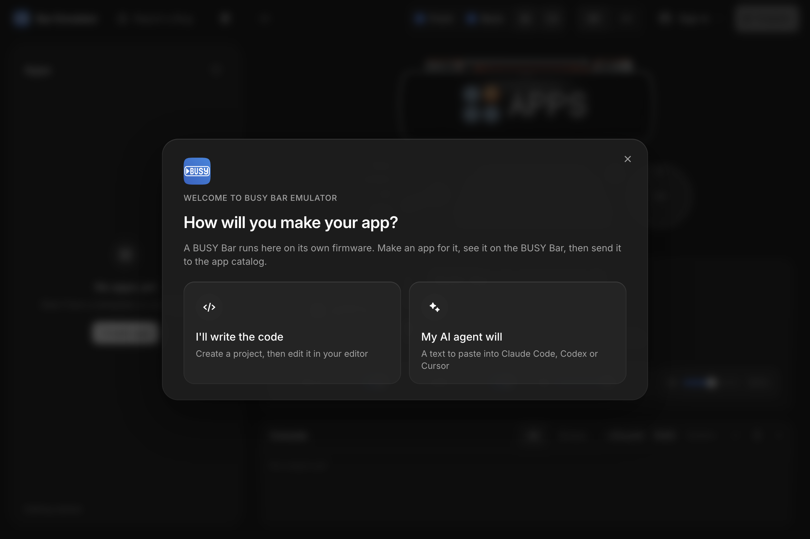

## 2. 在窗口中手动操作

### 创建应用

按下应用列表顶部的 **创建应用**（或菜单“文件 → 新建应用…”）。对话框有五个标签页：

- **模板**：官方模板，或三个完整示例之一（Focus Timer、Meeting Cost、Status Board）。选一个，给应用起个
  名字，并检查 Location——项目要放进的文件夹。
- **空白应用**：名称、一句话简介、分类和图标：可以是由名称生成的字母图标、内置绘制图标之一，或者通过
  **上传图标** 使用你自己的 8×8 像素 PNG（背面还可以再加一张 11×11 的，可选）。
- **打开已有项目**：你已有的项目。选择它的文件夹或其中任意文件。模拟器会问一次你是否信任该文件夹，
  因为构建项目会运行其中的代码。
- **从 GitHub 导入**：github.com 上的一个仓库。按[发布到 GitHub](#发布到-github)中的方式登录，粘贴
  仓库地址，检查 Location 后按下 **导入**。模拟器会下载它，并像“打开已有项目”一样询问你是否信任该文件夹。
- **安装软件包**：别人构建好的应用包（`.tgz`）。模拟器会显示应用的名称、id 和版本，只有在你选择“安装”
  时才安装。它会出现在应用列表中，但没有项目文件夹。

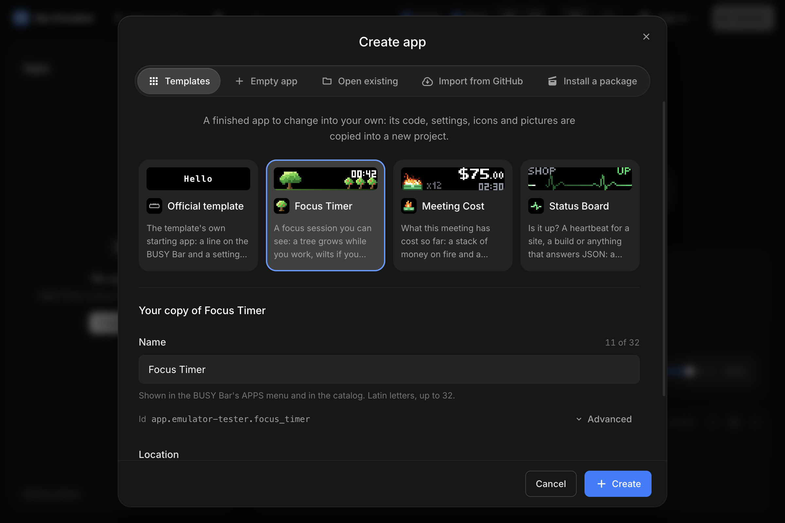

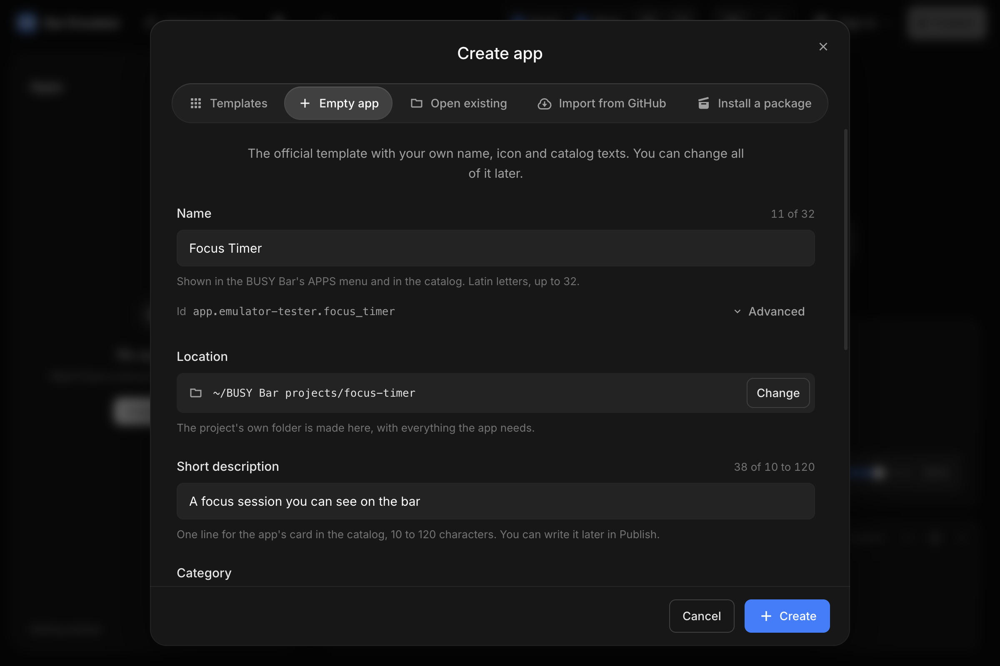

按下 **创建**。模拟器会创建项目、构建它、安装到收工牌上并启动。第一个项目需要从 npm registry 下载模板
及其依赖包，可能要用一分钟。

### 编写代码并运行

应用的代码是项目文件夹中的 `src/main.ts`。文件夹路径显示在应用栏的顶部，旁边有“复制”和
**在 Finder 中打开**（Windows 上为“在文件夹中显示”）；用你的编辑器打开该文件夹。收工牌能做什么，写在
项目的 `AGENTS.md` 和 `types/` 里。要与 AI 代理协作，按 **复制给 AI 的提示词**，把文本粘贴给代理：其中
包含应用的文件夹位置和模拟器的命令。

改完代码后，按应用栏中的 **运行**（应用运行中则为 **刷新**）。它会构建应用、安装到收工牌上并启动，与
`dev --once` 相同。**控制台**会显示应用用 `console.log` 打印的内容和错误。构建失败时，收工牌上保留的
仍是之前的版本。

窗口中收工牌的按键用法和真的收工牌一样：Start、Back 和滚轮（转动它，或按下表示确定）。应用的设置页在
应用的 **设置** 标签页，以及其末尾的 **在本地网页中打开**：收工牌没有键盘，所以它的设置放在收工牌的
网页上。**应用目录**标签页显示发布会要求什么、已经准备好多少；**文件**标签页列出哪些内容会进入应用的
公开仓库。

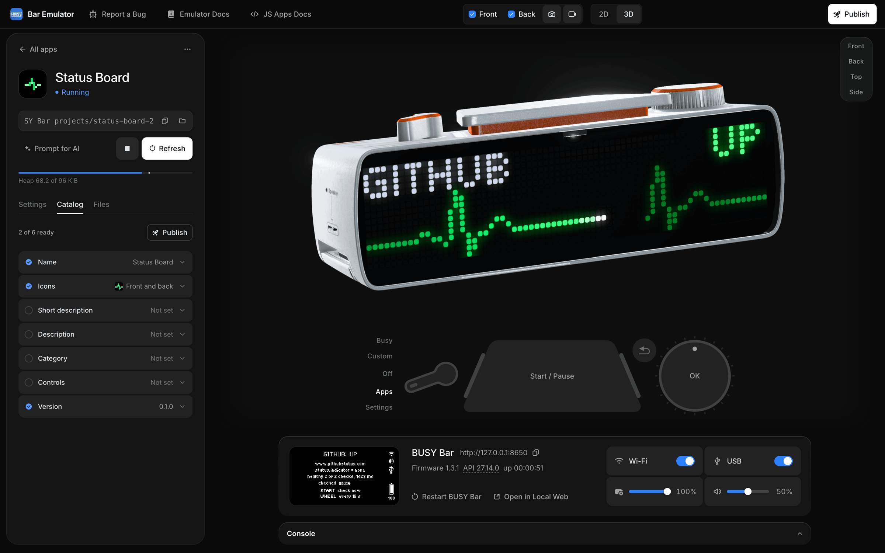

### 截图

把应用运行到最好看的画面。按收工牌上方的 **截图**，勾选“正面”“背面”或两者（macOS 为 Cmd+Shift+S，
Windows 为 Ctrl+Shift+S）。文件会进入项目的 `screenshots/`：正面 72×16，背面 160×80，正是应用目录要求
的尺寸。第一张正面截图就是应用在应用目录里的封面。

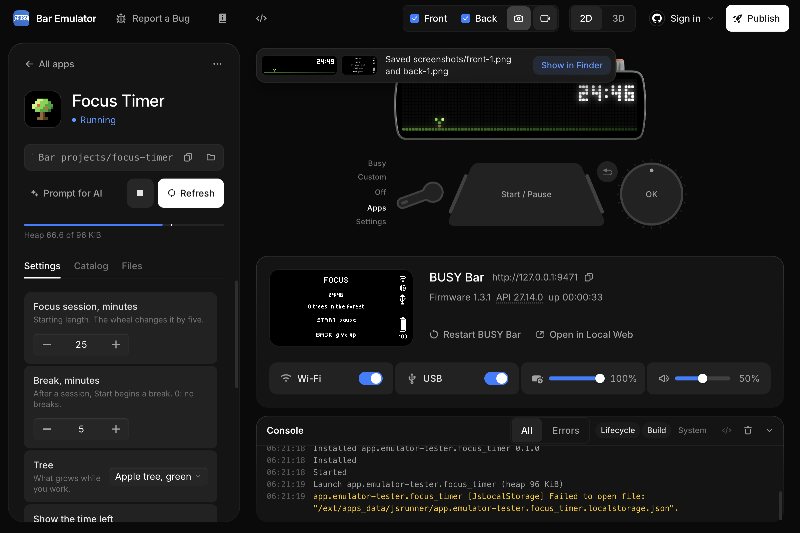

### 为你的帖子制作短片

按窗口顶栏中相机旁的 **录制**，选择要录什么：**窗口**——你看到的整个窗口；**帖子，1080×1920**——竖置的
收工牌，适合 Reels、TikTok 和 X；或 **正面屏幕**——只有正面屏幕。按钮会变红并计时。再按一次停止，然后
选择 MP4 保存位置。录制满 2 分钟会自动停止。

命令行可以做出同样的短片，还能做一张正面屏幕的 GIF。在项目文件夹里打开终端。macOS 上：

```sh
~/.busy-emulator/bin/busy-emulator record --seconds 10                # media/clip-1.mp4 of the window, as you see it
~/.busy-emulator/bin/busy-emulator record --layout post               # 1080×1920, the BUSY Bar alone, for a vertical post
~/.busy-emulator/bin/busy-emulator record --gif                       # media/clip-1.gif of the front display
```

Windows 上，在 PowerShell 中：

```powershell
& "$env:LOCALAPPDATA\busy-emulator\bin\busy-emulator.exe" record --seconds 10
```

短片会进入项目的 `media/`。录制默认短片期间，可以在窗口里操作收工牌的按键：短片会把它录进去。更多：
[为你的帖子制作短片](first-app.md#给帖子录一段视频)。

### 为应用目录做准备

按收工牌上方的 **发布**（或应用 **…** 菜单中的 **发布…**）。对话框左侧列出各个步骤。第一阶段“准备”
中，没有任何东西离开你的电脑。**下一步**会保存当前步骤；在步骤完成之前它是灰的，旁边标着原因。已完成
的步骤会打勾，也可以重新打开。随时可以关闭对话框：再次打开时会跳到第一个未完成的步骤。

1. **应用信息。** 应用的图标、名称、分类、一句话简介（应用卡片上的一行）、详细介绍和更新内容。输入时会
   即时检查应用目录的长度限制。
2. **截图。** 你截的图，按应用目录的顺序排列。**从收工牌截取**会当场截一张；**上传…**可加入你自己做的
   PNG（72×16 或 160×80，或它们的整数倍放大图）。可以重新排序或删除。第一张正面截图是封面。
3. **README。** 你仓库的首页。写一个标题和一段关于应用的介绍。在 **使用方法** 下面，为应用用到的每个
   控件加一行（Start、滚轮转动、滚轮按压、Back），每行配一句说明它做什么的短句。此步骤至少需要一行。
   也可以直接用 Markdown 写完整篇 README。截图、设置、构建方法和许可证行会自动替你加好。
4. **许可证。** 应用目录只收开源应用。在 MIT、Apache 2.0 或 GPL 3.0 中选一个——每个都有通俗的解释——并
   填写版权持有人：你的名字，或你所在组织的名字。也可以选 **上传许可证文件…** 使用你自己的许可证。
   模拟器永远不会替你选择。
5. **仓库文件。** 哪些内容进入公开仓库。取消勾选即可让某个文件不进入。任何看起来像密钥或个人数据的
   内容都会被标记：把它留在仓库外，或者如果它确实应该发布，就选择“仍然发布”。
6. **发布前检查。** 构建应用并检查类型，然后一次性跑完应用目录的全部检查。每个问题都会标出所属步骤并
   附 **前往**，或标出文件和行号并附 **打开**。检查之后改了文件，窗口会提示“检查后有改动”，并在你继续
   之前重新检查：只有检查过并打包好的内容才会发到 GitHub。
7. **构建并打包。** 构建应用，并把应用目录的条目 `applications/<app id>/manifest.yml` 写进项目的
   `submission/`。“可以发布”会说明将要发送的内容：你的源文件发到 GitHub，一个文件发到应用目录。

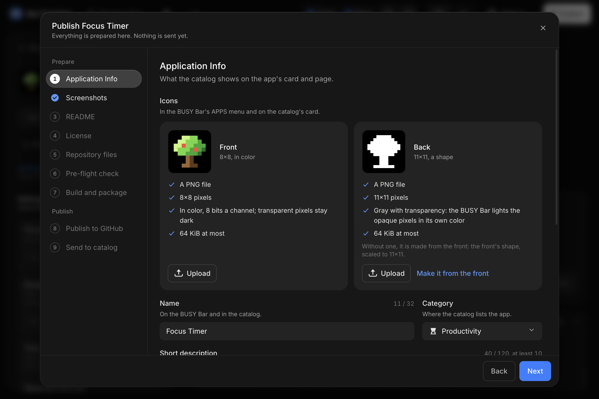

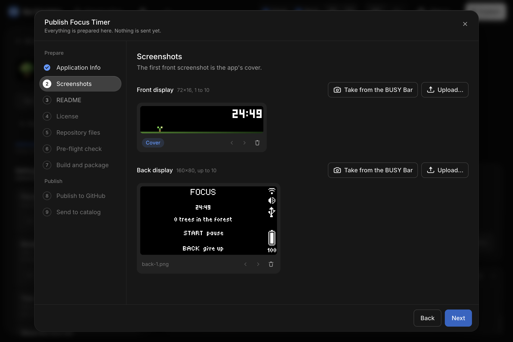

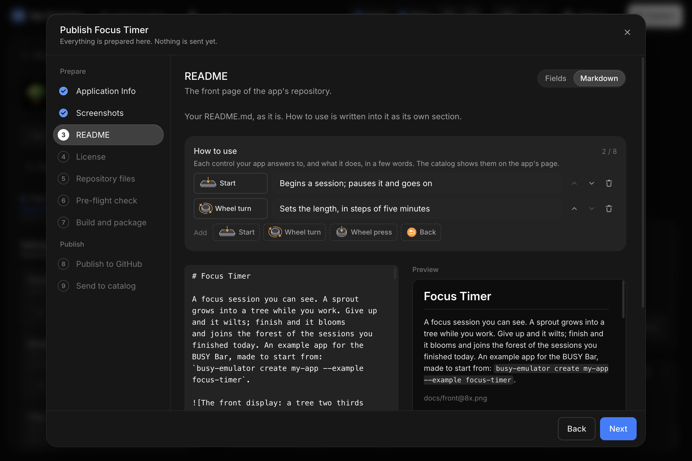

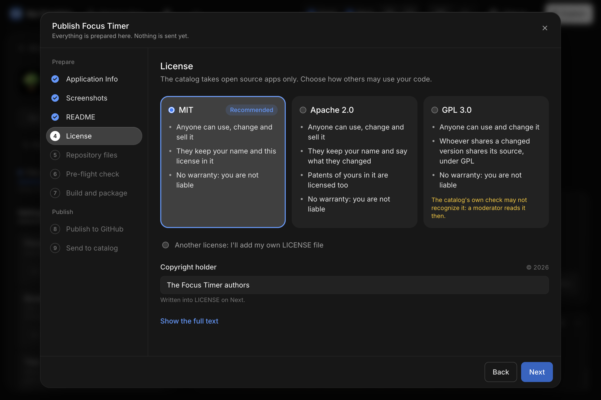

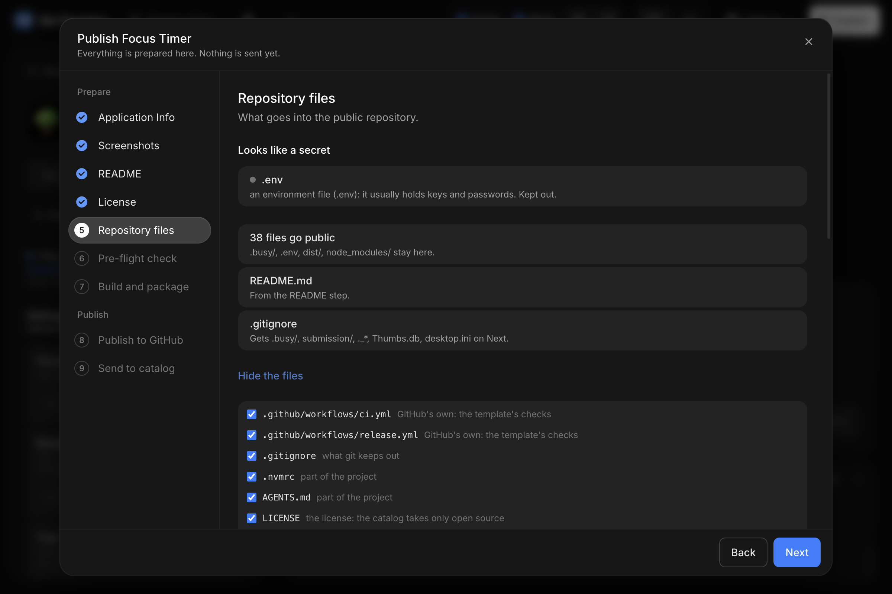

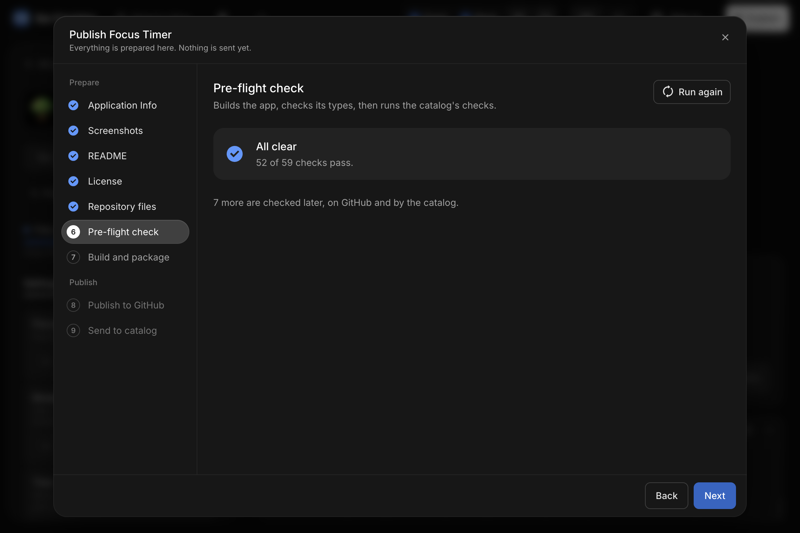

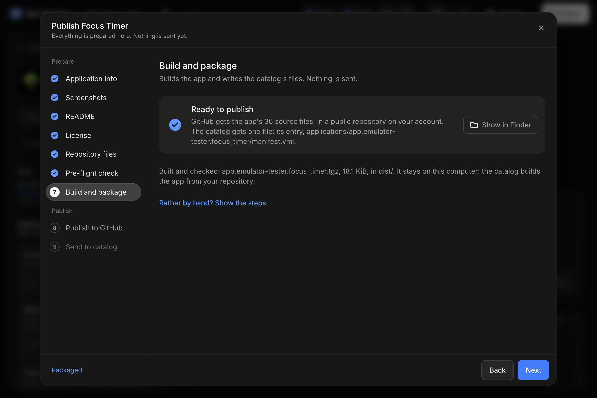

项目会把你的进度保存在 `.busy/publish.json` 中，该文件不进入 git。每一步的详细说明：
[分步发布](first-app.md#分步发布)。

### 发布到 GitHub

第二阶段“发布”从 **发布到 GitHub** 开始。首先是账号：

- 如果这台电脑上的 GitHub CLI 已经登录，会列出已有的账号。选择要用来发布的那个。
- 否则，或者点了 **使用其他账号登录**，窗口会显示一个验证码。选择 **打开
  github.com/login/device**，在那里输入验证码并授权 **GitHub CLI**。验证码也已复制到剪贴板。

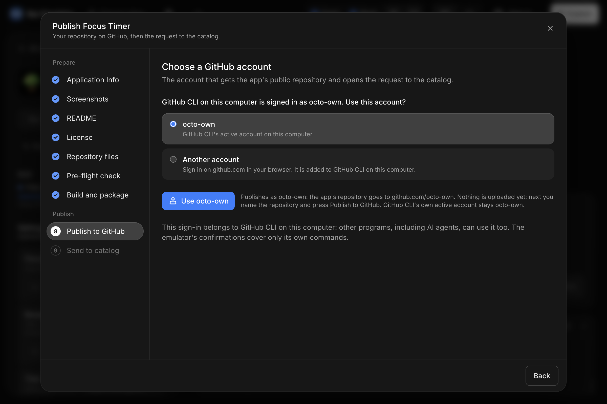

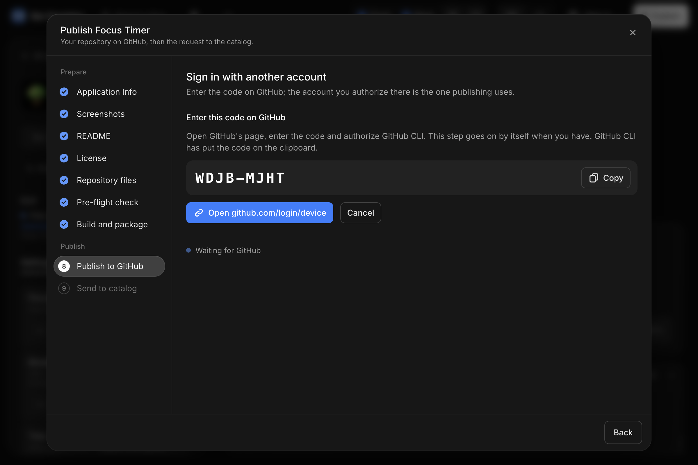

GitHub 会请求访问你的仓库、你所在组织的成员资格和你的 gists：这是 GitHub CLI 一贯的权限请求。模拟器用
它来创建一个公开仓库和对应的拉取请求。模拟器和 GitHub CLI 都看不到你的密码，令牌保存在系统的密码存储
中。

然后检查 **仓库** 名称（默认是应用名，可修改），按下 **发布到 GitHub**。一个收工牌图案会显示上传进度；
在 GitHub 上发生任何变化之前，“取消”都能中止它。完成后，窗口会显示仓库链接和对应的提交。以后再次发布
会更新同一个仓库。

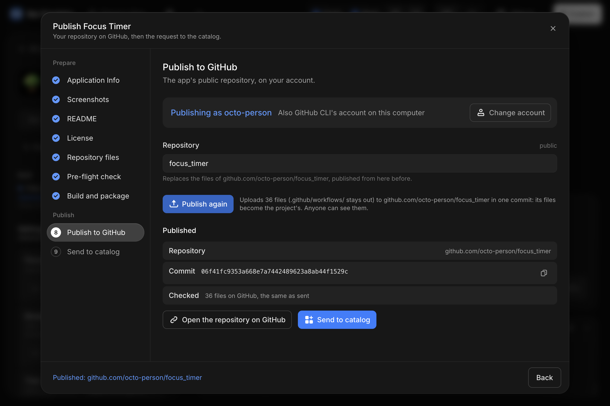

### 发送到应用目录

按下 **发送到应用目录**。这一步会显示应用目录自己的拉取请求 checklist，与应用目录模板里写的一致：

- 我已阅读作者条款，且我的应用符合条款要求
- 我是该应用的作者，或拥有其仓库的写权限
- 应用能通过 `busy-cli build` 构建，且锁定文件已提交
- manifest 符合应用目录的 manifest 格式
- 我已在运行最新正式版固件的收工牌上测试过该应用
- 截图取自收工牌
- （可选）我的应用参加 BUSY JS 应用大赛，并接受大赛规则

你屏幕上看到的清单是在这一步打开时从应用目录读取的，所以可能与上面这份不同。逐项阅读，属实就打勾：
你勾的每一项都会以已勾选的状态进入请求。除标记为可选的项外，**发送到应用目录** 在所有项都勾选之前保持
不可用；只有真的参加比赛时才勾比赛那一项。

然后选择 AI 的使用情况：**未使用 AI**、**部分由 AI 辅助** 或 **完全由 AI 生成**。请求中会保留这一行。
按下 **发送到应用目录**。窗口会显示拉取请求的链接。应用目录的检查在 GitHub 上运行；之后由审核员审查
应用。

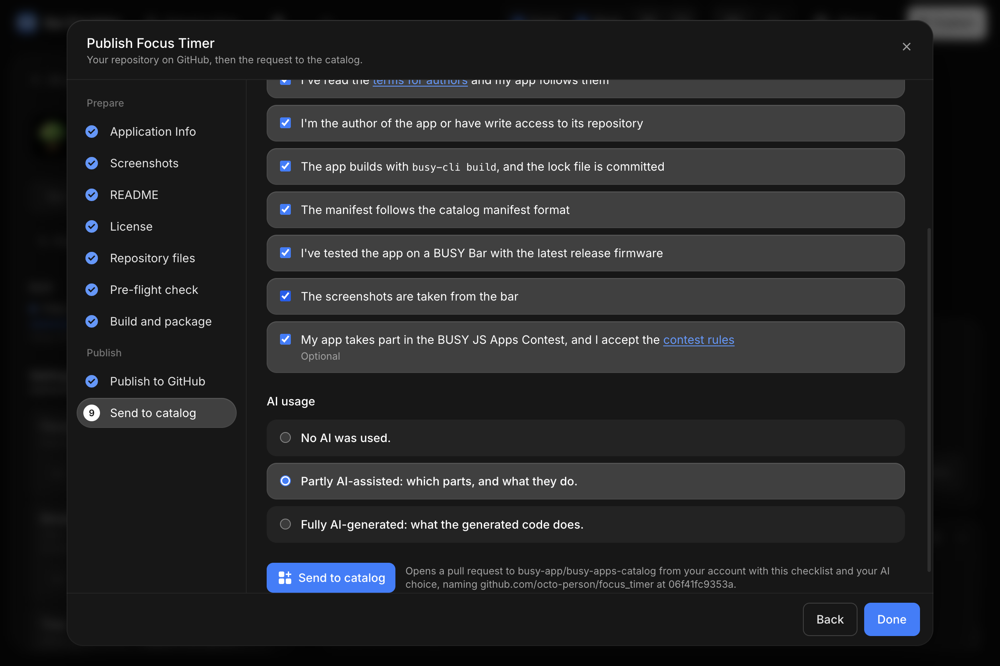

如果某项对你不成立——比如你没有收工牌——就不要勾。改为手动发送请求
（[手动发送](first-app.md#手动发送)），并在其中说明哪些项没法勾、为什么。模拟器在
`submission/PR-DESCRIPTION.md` 中准备好的文本已经写明：应用是在模拟器上运行的，而非收工牌。

<!-- 当应用目录为没有收工牌的作者更新 checklist 时，同步更新这一段（EMU-175）。 -->

发送到应用目录会把请求发到 BUSY 应用目录，https://github.com/busy-app/busy-apps-catalog；步骤中也写着
这个名字。

## 3. 借助 AI 代理

### 要对它说什么

在首次运行的问题中选择 **交给我的 AI 代理**（或稍后打开“入门指引”）。窗口会显示一段文字，其中包含命令
行在你电脑上的路径。按 **复制**，粘贴给你的代理，并在末尾加上你的想法。**先创建项目文件夹** 会在你
选择的文件夹中创建项目，之后那段文字会指明它。

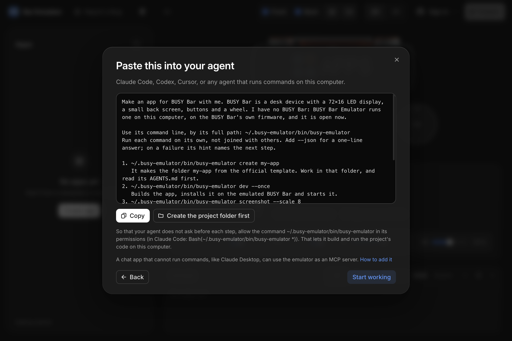

不用窗口的话，两句话就够了。如果模拟器还没装，代理会先装它：

```text
Make me a BUSY Bar app: <your idea>.
Follow https://go.busy.app/agents. I have no BUSY Bar, so use BUSY Bar Emulator as that page says.
```

当应用达到你想要的样子，再要求剩下的部分：

```text
Get it ready for the BUSY Apps Catalog and send it. Ask me for everything only I can decide.
```

允许代理运行 `busy-emulator` 命令行，否则它每步都要问你。这样它才能在你的电脑上构建并运行项目的代码。
窗口中那段文字下方给出了 Claude Code 对应的权限规则。如果你的代理在沙箱里运行命令，这条命令必须放在
沙箱外运行（否则报 `blocked_network`：
[故障排除](troubleshooting.md#blocked_network-或-blocked_file)）。

### 代理能独立完成的事

- 征得你同意后安装模拟器并启动它。
- 创建项目、编写应用、构建并运行到模拟的收工牌上。
- 截图并查看截图、读取应用的控制台输出、按按键、为计时器快进时间，并修复发现的问题。
- 制作图标、撰写应用目录所需的文案和带“使用方法”的 README、拍摄应用目录要求的截图。
- 编写 `.gitignore`、运行应用目录的检查并打包。
- 用 `record` 为你的帖子制作短片。

这一切你都可以在窗口里看着它做：收工牌显示应用，控制台显示它的输出。

### 只能由你完成的事

模拟器会在它自己的窗口里问你，或者由代理在聊天中问你并转达你的回答。命令行没有任何选项能替你回答
这些问题。

| 由你完成的步骤 | 在哪里回答 |
|---|---|
| 信任一个不是模拟器创建的文件夹（克隆、副本、用 `npm create` 建的项目） | 模拟器的对话框：**信任** 或 **不信任**。代理运行 `trust`，由你点击 |
| 选择许可证和版权持有人 | 在聊天中。代理写入你选择的许可证 |
| 登录 GitHub 并选择账号 | 模拟器的对话框：点账号名对应的 **使用**，或在 github.com/login/device 输入验证码 |
| 确认上传到一个新的公开仓库 | 模拟器的对话框：**发布** 或 **取消** |
| 选择 AI 的使用情况 | 在聊天中：未使用、部分使用或完全使用 |
| 勾选应用目录的 checklist 并确认请求 | 模拟器的对话框：勾选，然后 **继续**（或 **发送**）或 **取消** |
| 勾选可选项，比如比赛 | checklist 之后单独的对话框：勾选或留空 |

对话框会出现在模拟器窗口的最前面，且弹出后第一秒内的“确定”不会被接受，这样误触的按键不会替你作答。
如果你选了“取消”，什么都不会发出去，代理也不应再问，除非你让它问。阅读每个对话框：上面写着文件夹、
仓库和应用目录的名字。

登录信息属于这台电脑上的 GitHub CLI，所以其他程序——包括你的代理——也能用它。模拟器的对话框只管它自己
的命令。要收回这份授权，见
[发布到 GitHub](troubleshooting.md#发布到-github-github-cli-请求访问你的仓库)。

### 收尾

代理的最后一条回复里有拉取请求的链接。打开它：应用目录的检查在那里运行，然后由审核员审查应用。你在
对话框里勾选的可选项（比如 BUSY JS 应用大赛）也会在里面呈勾选状态。窗口中的 **发布** 显示每一步的
状态，已完成的步骤都打勾。代理从命令行也能读到同样的信息：

```sh
~/.busy-emulator/bin/busy-emulator publish status
```

## 4. 发送之后

- **提交请求后的修改。** 修改应用，然后重新发布：**发布到 GitHub** 会更新同一个仓库，**发送到应用目录**
  会更新同一版本的未结请求。应用目录构建的正是请求中指明的那个提交。
- **新版本。** 提高 `src/appmeta/manifest.json` 中的 `version`，在“应用信息”里写好更新内容，然后重新
  构建打包、发布、发送。新版本会开启一个新的请求。
- **你的帖子。** 短片在项目的 `media/`，截图在 `screenshots/`。发帖时附上放大版（`front-1@8x.png`）；
  应用目录只收小图。
- **出问题时。** 命令行的每个回答都会告诉你下一步做什么。各错误码以及窗口的提示都收录在
  [故障排除](troubleshooting.md)中。

## 需要截取的图片

窗口自身的插图由 `packages/app/test/app/guide-shots.test.mjs` 生成：以 `GUIDE_SHOTS=<folder>` 运行它，
然后无损优化这些 PNG 并复制到 `public-docs/images/`。它截取的是一个 1200×800 的窗口，运行着用
Focus Timer 示例做的应用，位于名为 "you" 的用户主目录中，GitHub CLI 与 GitHub 的账号为替身账号
octo-person 和 octo-own。本文档没有收录系统自身窗口（macOS 的“隐私与安全性”、Windows SmartScreen）
和模拟器消息框（信任对话框和发布对话框）的截图：测试截不到它们。每张图都是 `public-docs/images/` 下的
一个 PNG，文件名如下。

| 文件 | 画面内容 |
|---|---|
| `guide-welcome.png` | 首次运行的问题：我自己写代码、交给我的 AI 代理 |
| `guide-create-app-templates.png` | 创建应用，模板标签页，官方模板和三个示例 |
| `guide-create-app-empty.png` | 创建应用，空白应用标签页，已填名称、分类和一个字母图标 |
| `guide-window-app-running.png` | 运行着 Status Board 的整个 3D 窗口：收工牌、按键、停在“应用目录”标签页的应用栏、收工牌卡片 |
| `guide-screenshot.png` | 收工牌上方的截图控件，已勾选正面和背面 |
| `guide-publish-app-info.png` | 发布，应用信息，已填写 |
| `guide-publish-screenshots.png` | 发布，截图，含一张正面和一张背面截图 |
| `guide-publish-readme.png` | 发布，README，含两行“使用方法”和预览 |
| `guide-publish-license.png` | 发布，许可证，已选 MIT，版权持有人已填写 |
| `guide-publish-files.png` | 发布，仓库文件，列表已展开，一个文件被标记为疑似密钥 |
| `guide-publish-check.png` | 发布，发布前检查，全部通过 |
| `guide-publish-package.png` | 发布，构建并打包，可以发布 |
| `guide-publish-account.png` | 发布到 GitHub，选择 GitHub 账号，列出了一个账号 |
| `guide-publish-code.png` | 发布到 GitHub，在 GitHub 上输入此验证码，显示验证码 |
| `guide-publish-github-done.png` | 发布到 GitHub，已发布，显示仓库和提交 |
| `guide-send-to-catalog.png` | 发送到应用目录，checklist 已勾选、AI 使用情况已选，在点击发送之前 |
| `guide-agent-text.png` | 把这段文字粘贴给你的代理：文本、复制按钮和“先创建项目文件夹” |

不出现其他应用、真实人名、带真实用户名的路径：使用名为 "you" 的用户，或把路径裁掉。
